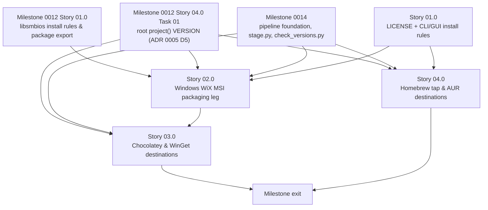

# Milestone 0015 - End-User Distribution and the Windows Installer

**Package:** `smbios` (CLI) and `smbios_gui` (GUI) as **end-user installables**, plus the Windows MSI | **Module root:** `LICENSE`, `smbios/src/CMakeLists.txt`, `smbios_gui/CMakeLists.txt`, `packaging/windows/`, `packaging/homebrew/`, `packaging/aur/`, `scripts/ci/destinations/`

Implements [docs/adr/0006-end-user-distribution-and-windows-installer.md](/docs/adr/0006-end-user-distribution-and-windows-installer.md)
Wave 1 in full: the three prerequisites that ADR's D7 names as blocking
(an MIT `LICENSE`, and `install()` rules for the CLI and the GUI - the
version source itself belongs to milestone 0012), the **WiX MSI** of D3
with its four-feature tree, and the four Wave 1 **publish destinations**
of D2 (Chocolatey, WinGet, a Homebrew tap, AUR). Nothing in this milestone
is implemented yet; every story and task below starts "Not started."

This milestone is the **end-user axis** of ADR 0006's D1 split.
[Milestone 0012](/docs/roadmap/0012-package-manager-distribution/plan.md)
keeps the developer axis (vcpkg, `pkg-config`, the `libsmbios` CMake
package export) and this milestone changes nothing in it. The two axes
meet in exactly one place: the MSI's optional `SDK_Shared`/`SDK_Static`
features carry developer payloads alongside the CLI and GUI, which is a
packaging convenience, not a scope change.

**It adds no pipeline.** Per ADR 0006 D5, the MSI is a new `package`-stage
**leg** over the already-tested `cmake --install` tree (ADR 0005 D4) and
each channel is a **destination plug-in** (ADR 0005 D9): a
`scripts/ci/destinations/<name>.py` module plus one row in
`scripts/ci/publish_destinations.json`. Adding a destination inside an
existing permission class needs no workflow edit, so this milestone
creates **no new workflow file at all**.

## Stories

| Story | Name                                                 | Category       | Output                                                                                     |
|-------|------------------------------------------------------|----------------|--------------------------------------------------------------------------------------------|
| 01.0  | Licence, and end-user `install()` rules for the CLI and GUI | infrastructure | An MIT `LICENSE` with an SPDX identifier (ADR 0006 D7.1, resolving milestone 0012's open question H3); first-ever `install()` rules for `smbios` and `smbios_gui`, so the `package` stage can archive them at all (D7.3) |
| 02.0  | Windows WiX MSI packaging leg                        | infrastructure | `packaging/windows/*.wxs` + a `windows-msi` `package`-stage leg building the MSI **from the install tree**, with ADR 0006 D3's four-feature tree (`CLI`, `GUI`, `SDK_Shared`, `SDK_Static`), a permanent `UpgradeCode` and stable component GUIDs; the MSI and its `.sha256` land in the same `manifest.json` as the tarballs |
| 03.0  | Chocolatey and WinGet publish destinations           | infrastructure | `scripts/ci/destinations/{chocolatey,winget}.py` + registry rows + `packaging/chocolatey/` (`nuspec`, `chocolateyInstall.ps1`, `VERIFICATION.txt`) and the WinGet multi-file manifest template; two new `check_versions.py` version sites |
| 04.0  | Homebrew tap and AUR publish destinations            | infrastructure | `scripts/ci/destinations/{homebrew_tap,aur}.py` + registry rows + `packaging/homebrew/libbios.rb.in` and `packaging/aur/PKGBUILD.in`; the two Wave 1 channels that need no code signing and no third-party review queue |

## Rationale

ADR 0004's Alternative 4 deferred the end-user axis to "its own future
ADR"; ADR 0006 is that ADR, and this milestone is its Wave 1. The story
order is forced by real dependencies, not by preference:

- **Story 01.0 first, because nothing else is possible without it.** ADR
  0005 D4 fixes the `package` stage's only input as the build stage's
  already-tested `cmake --install` tree. `smbios` lands in build-tree
  `smbios/bin/` and `smbios_gui` in `smbios_gui/bin/`, and **neither has
  an `install()` rule anywhere in the repository** - so today the CLI and
  the GUI cannot be packaged by any channel at all. This is the
  prerequisite ADR 0006 D7.3 records as newly discovered: milestone 0012
  Story 01.0 scopes itself to `libsmbios`'s *library* export and does not
  cover the two executables. The same story adds the `LICENSE` every row
  of ADR 0006's matrix requires as package metadata (Chocolatey's
  `licenseUrl`, WinGet's `License`, the MSI's displayed licence,
  Homebrew's audit).
- **Story 02.0 second, because three of the four channels reference its
  output.** The Chocolatey package wraps the MSI, the WinGet manifest
  points at the MSI's Release URL and digest, and only the Homebrew/AUR
  pair is independent of it.
- **Stories 03.0 and 04.0 are independent of each other** and can be
  implemented concurrently. 04.0 is deliberately listed last despite
  being the *cheaper* pair (no signing, no external review queue - ADR
  0006 DD1/DD5), because 03.0 is the pair the maintainer's request named.

The reason this milestone is small for the reach it buys is ADR 0006 D5:
the gating, digest discipline, tier rules, credential handling and
`check_published` verification already exist in ADR 0005's publish stage.
Each channel here is a module and a data row, not a release process.

## Key constraints

- **One version source, no new one.** The root `CMakeLists.txt`
  `project(... VERSION)` is authoritative (ADR 0005 D5), and adding it is
  **milestone 0012 Story 04.0 Task 01's** task, not this milestone's. Every
  manifest here derives from it and is checked by 0014's
  `check_versions.py`; no story below introduces its own version literal.
- **No new workflow file, and no new job in the entry workflow.** ADR 0005
  D8's file family and 0014's policy allowlist P9 are unchanged by this
  milestone. The MSI is a leg of the existing `package` stage; the four
  channels are matrix entries of the existing `stage-publish.yml`
  permission-class jobs (ADR 0005 D9).
- **Every destination here is `release` tier.** It runs only on a `v*`
  tag, only after `verify` passed in the same run (ADR 0005 D6), and - per
  D9's CR-2 rule - refuses any manifest leg whose `binary_cache` is
  `restored`. None of these channels has a `staging` counterpart.
- **A destination never builds, re-archives or recomputes digests.** The
  `manifest.json` is its only source of truth (ADR 0005 D4/D9). The
  Chocolatey package and the WinGet manifest both carry the *manifest's*
  digest for the MSI, never one computed at publish time.
- **No artifact is setuid, setcap, or installs a privileged helper**
  (ADR 0006 D6/DD3). The AUR package documents `sudo smbios`; the GUI
  keeps milestone 0011's root warning. A reviewer finding a `setuid` bit
  in any artifact this milestone produces is a hard failure, and Story
  01.0 Task 03 asserts its absence.
- **Linux and macOS package metadata must state the privilege
  requirement** (ADR 0006 D6): an unprivileged `smbios` run on Linux
  falls through the entire source chain, which a user who typed a package
  manager command will read as "broken", not as "needs root".
- **`libsmbios` stays a static archive and `smbios_c` stays the one
  `SHARED` target.** ADR 0006 D4 rejects a shared C++ `libsmbios.dll`;
  the MSI's `SDK_Shared` feature is `smbios_c`, and `SDK_Static` is
  `libsmbios`. No story below adds `dllexport` machinery to `libsmbios`
  or sets `WINDOWS_EXPORT_ALL_SYMBOLS`.
- **Every verification task here is a packaging-correctness test, not a
  unit test.** None is a Boost.Test case under
  `tests/unit|mock|perf|integration/`. They are clean-room tests on a
  fresh runner against published or installed artifacts only, the pattern
  milestone 0007 Story 03.0 Task 02 and milestone 0012 established.
- **The MSI is built from the install tree, never by CPack.** ADR 0006 D3
  decides this and gives the reason (CPack runs from the build tree,
  which either bypasses or re-derives the tested install tree ADR 0005 D4
  fixes as the stage's only input, and moves packaging logic into CMake
  against ADR 0005 DD5). No story below adds `include(CPack)`.

## Non-goals

- **Wave 2, 3 and rejected channels from ADR 0006 D2** - Scoop, Homebrew
  cask and core, `.pkg`/`.dmg`, Fedora COPR, a self-hosted apt repo,
  AppImage, Debian/Fedora official, PPA, Nixpkgs, OBS, and the rejected
  Snap/Flatpak/MSIX rows. Wave 2 starts only after Wave 1 survives two
  consecutive releases with no manual intervention (ADR 0006's promotion
  trigger).
- **Code signing** - no Authenticode certificate, no Apple Developer ID,
  no notarization. ADR 0006 open question 2; Wave 1 ships with
  SmartScreen warnings on the MSI, which is a named, accepted consequence.
- **A macOS GUI distribution** - a Homebrew cask needs a `.app` bundle
  that does not exist (`smbios_gui` is a plain Mach-O executable), and an
  unsigned bundle still fails Gatekeeper. Wave 2.
- **A shared C++ `libsmbios`** - rejected by ADR 0006 D4 with four
  reasons; `smbios_c` is the supported dynamic surface.
- **`include(CPack)` or any CPack generator** - see Key constraints. ADR
  0006's alternatives table leaves CPack open as a *possible* Wave 2
  fallback for `DEB`/`RPM` only.
- **Any language-ecosystem channel** (PyPI, crates.io, NuGet, npm) -
  ADR 0006 D2's fourth column, owned by
  [milestone 0013](/docs/roadmap/0013-language-bindings/plan.md).
- **A semantic-versioning or ABI-stability policy** - still deferred
  (ADR 0004 DD2, milestone 0007 Non-goals). This milestone consumes
  whatever version 0012 Story 04.0 Task 01 establishes.
- **Changing any C/C++ API surface, entry type, or output formatter.**
  This milestone is purely a distribution-channel change, as 0012's was.

## Shared contracts

### C1 - End-user install layout (`GNUInstallDirs`-based, Story 01.0)

Every channel in ADR 0006's matrix consumes the same install tree, so the
tree's shape is a contract, not a per-channel choice. Story 01.0 defines
it once with `GNUInstallDirs`:

```
${CMAKE_INSTALL_PREFIX}/
  bin/smbios[.exe]              # CLI          - MSI feature CLI, brew/AUR bin
  bin/smbios_gui[.exe]          # GUI          - MSI feature GUI (opt-in CMake build)
  lib/libsmbios.a | libsmbios.lib + the per-OS/legacy archives
                                #              - MSI feature SDK_Static (milestone 0012 Story 01.0)
  lib/libsmbios_c.so|.dylib | bin/smbios_c.dll + lib/smbios_c.lib
                                #              - MSI feature SDK_Shared (milestone 0007)
  include/libsmbios/**          # C++ headers  - SDK_Static
  include/smbios/smbios.h       # C ABI header - SDK_Shared (milestone 0007)
  lib/cmake/libsmbios/**        # package cfg  - SDK_Static (milestone 0012 Story 01.0)
  lib/pkgconfig/smbios_c.pc     # pkg-config   - SDK_Shared (milestone 0007)
  share/doc/libbios/LICENSE     # licence      - every channel's metadata
```

Two rules bind every story below:

- **`smbios_gui`'s install rule is guarded by `SMBIOS_BUILD_GUI`.** The
  GUI is opt-in and OFF by default, so a non-GUI build must still produce
  a complete, installable tree - just one without `bin/smbios_gui`. The
  MSI's `GUI` feature is therefore conditional on the packaging leg being
  a GUI-enabled configuration, which Story 02.0 Task 02 states explicitly
  rather than assuming.
- **The install tree is the single definition of "what ships."** The
  tarballs (milestone 0012 Story 03.0), the MSI (Story 02.0) and the
  Homebrew/AUR packages (Story 04.0) all read this tree and nothing else.

### C2 - MSI feature tree and upgrade identity (`packaging/windows/`, Story 02.0)

ADR 0006 D3's feature tree, with the identity values that make upgrades
work. These are contract values: once published, changing one is a
user-visible defect.

| Feature | Payload (from C1) | Default | Extra action |
|---|---|---|---|
| `CLI` | `bin/smbios.exe` | **on** | appends its directory to the **per-machine** `PATH` |
| `GUI` | `bin/smbios_gui.exe` | **on** | Start Menu shortcut; no `PATH` entry |
| `SDK_Shared` | `bin/smbios_c.dll`, `lib/smbios_c.lib`, `include/smbios/smbios.h` | off | the **dynamic** library (`smbios_c`) |
| `SDK_Static` | `lib/libsmbios.lib` + per-OS/legacy archives, `include/libsmbios/**`, `lib/cmake/libsmbios/**` | off | the **static** library; needs milestone 0012 Story 01.0 |

- **`UpgradeCode` is permanent** - one GUID, fixed for the life of the
  product, recorded in `packaging/windows/identity.md` with a comment
  saying it must never change. A changed `UpgradeCode` turns every future
  upgrade into a side-by-side second installation.
- **Component GUIDs are stable**, authored explicitly rather than
  auto-generated per build, so a major upgrade replaces files instead of
  accumulating them.
- **`Version` comes from ADR 0005 D5's single source**, injected into the
  `.wxs` at package time; `check_versions.py` gains it as a version site.
- **Per-machine install** into `Program Files`, with the licence from C1
  displayed in the UI. The installed programs need **no elevation to
  run** (Windows' `GetSystemFirmwareTable()` needs no admin) - only the
  per-machine install itself does.

### C3 - Destination module contract (ADR 0005 D9, Stories 03.0 and 04.0)

Each of the four channels is one module under `scripts/ci/destinations/`
implementing ADR 0005 D9's interface (`NAME`, `REQUIRED_ENV`,
`validate`, `publish`, `check_published`), Python stdlib only, registered
with one row in `scripts/ci/publish_destinations.json`:

| `NAME` | `tier` | `permission_class` | `environment` | Reads |
|---|---|---|---|---|
| `chocolatey` | `release` | `token-only` | `release` | the MSI entry of `manifest.json`; `CI_PUBLISH_CHOCO_API_KEY` |
| `winget` | `release` | `repo-write` | `release` | the MSI entry's public Release URL + digest; a fork-and-PR token |
| `homebrew-tap` | `release` | `repo-write` | `release` | the macOS tarball entries + digests |
| `aur` | `release` | `repo-write` | `release` | the source tarball entry + digest; an AUR SSH key |

- `validate` runs in `--dry-run` and before any write, prints nothing
  secret, and builds every remote location from validated parts only -
  the confinement discipline ADR 0005 D9 spells out for `s3_staging`.
- `check_published` re-reads the published copy and compares it with the
  manifest. For these channels this is **not ceremony**: a Chocolatey
  package that passes moderation while installing a wrong-digest MSI, or
  a WinGet manifest whose `InstallerSha256` drifted from the Release
  asset, is exactly the silent end-user breakage ADR 0006's D1 table
  flags as this axis's characteristic failure mode.
- A destination that becomes a maintenance burden is switched off by
  flipping `enabled` to `false` in the registry - no workflow change
  (ADR 0006's rollback plan).

## Dependency graph



**Cross-milestone dependencies are real, not narrative:**

- **Story 02.0 needs milestone 0012 Story 01.0**, because the MSI's
  `SDK_Static` feature installs `libsmbios`'s archives, headers and
  `libsmbiosConfig.cmake` - none of which exist until that story lands.
  Shipping the raw `.lib` without the whole-archive-safe exported target
  would hand every consumer the silent
  `SMBiosEntryFactory::create() == nullptr` footgun ADR 0004's DD1 exists
  to prevent.
- **Stories 02.0, 03.0 and 04.0 need milestone 0012 Story 04.0 Task 01**
  (the root `project(... VERSION)`), because every manifest, the MSI
  `Version`, the formula and the `PKGBUILD` derive from it.
- **All three need milestone 0014**, for `stage.py`, the reusable stage
  workflows, `check_versions.py` and the report contract.
- **Story 01.0 depends on nothing outside this milestone** - a `LICENSE`
  file and two `install()` rules touch no CI and no other milestone's
  work, so it can start immediately.
- **Stories 03.0 and 04.0 do not depend on each other** and their file
  sets do not overlap, so they can be implemented concurrently. Only
  03.0's dependence on the MSI (02.0) orders it.

## Links

- **ADR implemented:** [docs/adr/0006-end-user-distribution-and-windows-installer.md](/docs/adr/0006-end-user-distribution-and-windows-installer.md)
- **Prior ADR this one extends (developer axis, unchanged):** [docs/adr/0004-package-manager-distribution.md](/docs/adr/0004-package-manager-distribution.md)
- **Pipeline ADR (packaging legs D4, publish gating D6, destination plug-ins D9):** [docs/adr/0005-unified-build-package-publish-pipeline.md](/docs/adr/0005-unified-build-package-publish-pipeline.md)
- **Milestone this one depends on for install/export and the version source:** [docs/roadmap/0012-package-manager-distribution/plan.md](/docs/roadmap/0012-package-manager-distribution/plan.md)
- **Milestone this one depends on for the pipeline foundation:** [docs/roadmap/0014-ci-rework-from-scratch/plan.md](/docs/roadmap/0014-ci-rework-from-scratch/plan.md)
- **Milestone that owns the language-ecosystem channels:** [docs/roadmap/0013-language-bindings/plan.md](/docs/roadmap/0013-language-bindings/plan.md)
- **Milestone that produced the GUI this one newly distributes:** [docs/roadmap/0011-gui-visualization-tool/plan.md](/docs/roadmap/0011-gui-visualization-tool/plan.md)
