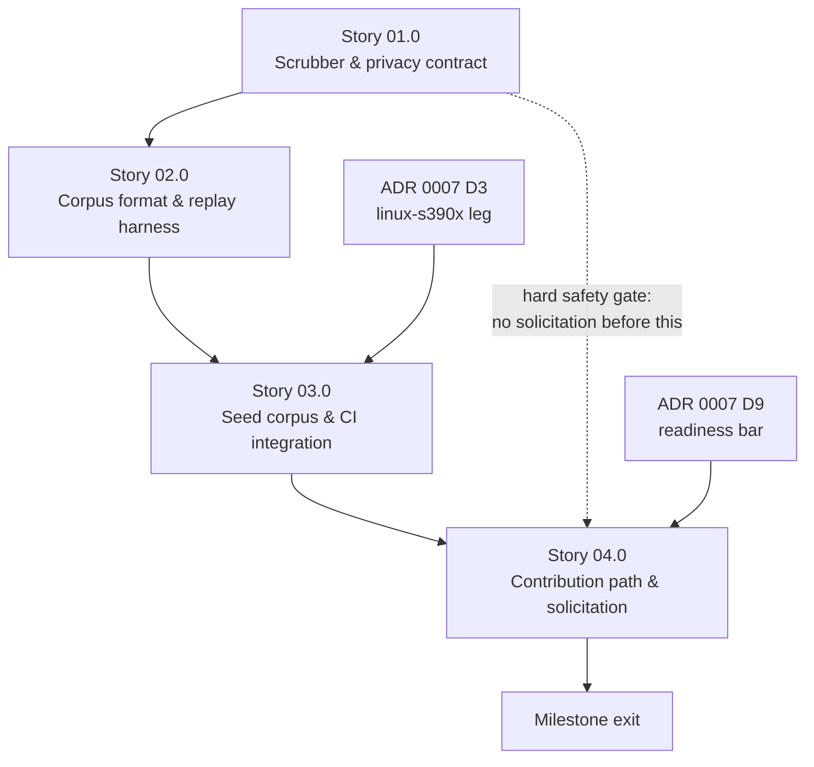

# Milestone 0016 - Real-Firmware Table Corpus

**Package:** a scrubbed corpus of **real** SMBIOS tables, replayed as test fixtures | **Module root:** `tools/smbios_scrub/`, `tests/data/corpus/`, `tests/unit/corpus_replay_test.cpp`, `scripts/ci/`

Implements [ADR 0007](/docs/adr/0007-ci-compute-architecture-coverage-and-self-hosted-surface.md)
D8's first half: shrink the self-hosted firmware lab (ADR 0007 D7's node
**S1**) by collecting **real firmware tables as data** instead of
acquiring machines, scrubbing them of personal identifiers, and replaying
them through the hermetic seam the unit suite already uses. Nothing in
this milestone is implemented yet; every story and task below starts
"Not started."

## Why this exists

Today the only test input for the parser is **synthetic**:
`SyntheticTableBuilder` (milestone 0006) constructs tables this project
wrote itself. That proves the parser handles what this project *imagined*
firmware does. It cannot prove it handles what a 2013 Dell OptiPlex, an
HP ProLiant with OEM structure types, or a Supermicro board with a
malformed string section actually does - and those are the tables the
library exists to read.

Buying that coverage as hardware is unbounded: one machine per vendor per
era. Collecting it as **data** is bounded and permanent:

- A donated dump is a few kilobytes and lives forever as a fixture.
- It runs **free on every runner and every architecture** - including
  ADR 0007 D3's big-endian `linux-s390x` leg, where a real vendor table
  replayed byte-for-byte is a far stronger endian test than any synthetic
  one.
- A vendor-specific parsing regression becomes a permanent named test
  case instead of "it broke on my old ThinkPad".

It scales with contributors rather than with the maintainer's budget -
one donated dump from an unusual board is worth more coverage than a
second laptop.

## What this milestone does **not** claim

**A corpus does not replace node S1.** It covers *table content*
diversity. It cannot cover *source acquisition*: whether
`LinuxSysfsSource` opens the right path, whether `LinuxEfiSource` parses
`/sys/firmware/efi/systab` correctly, whether `MacOsUefiSource` finds the
right IORegistry property, or whether the legacy `/dev/mem` scan still
works. Those need a real machine. S1 therefore shrinks from *one machine
per vendor* to **one machine per OS** - it does not disappear.

## Stories

| Story | Name                                             | Category       | Output                                                                                     |
|-------|--------------------------------------------------|----------------|--------------------------------------------------------------------------------------------|
| 01.0  | Scrubbing tool and the privacy contract          | infrastructure | `tools/smbios_scrub/` - a tool that removes every personally identifying field from a raw table dump, its test suite, and the written privacy contract stating exactly which fields are destroyed. **Must land before any dump is solicited** |
| 02.0  | Corpus format, storage and replay harness        | infrastructure | The on-disk fixture format (raw bytes + a metadata sidecar), `tests/data/corpus/` layout, and `CorpusReplay` - a harness feeding each fixture through the existing `SmbiosTableWalkTestAccess` seam alongside `SyntheticTableBuilder` |
| 03.0  | Seed corpus and CI integration                   | infrastructure | The maintainer's own machines contributed as the first fixtures; the corpus suite wired into `tests/unit/` so it runs on every Tier A leg **and** on ADR 0007 D3's `linux-s390x` leg - the endian proof |
| 04.0  | Contribution path and solicitation               | documentation  | A one-command contribution recipe, an issue/PR template, `CONTRIBUTING` guidance, and the public call for dumps - **gated** on Stories 01.0-03.0 and on ADR 0007 D9's readiness bar |

## Rationale

The story order is a **safety ordering**, not a preference:

- **01.0 is first because soliciting dumps before the scrubber exists
  would be an irreversible privacy failure.** Raw SMBIOS tables carry
  machine serial numbers, UUIDs and asset tags (Type 1 serial and UUID,
  Type 2 serial, Type 3 asset tag, Type 4 serial, among others). Once a
  contributor's machine UUID is in git history it is effectively
  permanent. ADR 0007 D8 states this as a precondition; this milestone
  enforces it by sequencing.
- **02.0 before 03.0** because the fixture format decides what a
  contributor is being asked for. Asking for dumps, then changing the
  format, wastes other people's effort.
- **03.0 before 04.0** because the seed corpus is what proves the harness
  works at all, and because a public call should point at a working,
  visibly useful thing rather than an empty directory.
- **04.0 is gated twice** - on this milestone's own stories and on ADR
  0007 D9's readiness bar. Inbound contributions outpace a single
  maintainer unless the automated suite already catches regressions.

## Key constraints

- **Scrub before solicit.** No task in Stories 02.0-04.0 may ask any
  third party for a dump until Story 01.0's tool and tests have landed.
  This is the milestone's single hardest rule.
- **The corpus is test data, not a source.** Fixtures feed the parser
  through `SmbiosTableWalkTestAccess`, exactly as `SyntheticTableBuilder`
  does. No `ISmbiosSource` implementation reads from `tests/data/corpus/`,
  and no shipped artifact contains it.
- **The corpus suite stays in `tests/unit/`** - the hermetic category
  (`docs/dev/cpp_coding_standard.md`'s four-category scheme). It needs no
  hardware and no privileges, which is exactly what lets it run under
  emulation on `linux-s390x`. It must never need root, a display or a
  network.
- **Fixtures are bytes plus metadata, never parsed output.** Storing a
  rendered parse would make the fixture a snapshot of today's parser and
  useless as a regression test against tomorrow's.
- **No GPL-derived data.** `c-versions/` holds GPL-2.0-or-later
  `dmidecode` sources as reference only (milestone 0008's isolation
  guard). Dumps are firmware output, not `dmidecode` source, but no test
  data may be copied out of that tree, and no fixture may be generated by
  compiling anything in it.
- **Scrubbing must preserve structure.** A scrubbed table must still be
  byte-valid: same lengths, same handles, same string-section framing.
  Replacing a serial with a shorter string and leaving the length field
  alone would produce a fixture that tests the scrubber's bug rather than
  the vendor's firmware.
- **A fixture is never silently repaired.** Deliberately malformed real
  tables are the most valuable fixtures in the corpus. The harness
  asserts memory safety and non-crashing behaviour, not a specific
  recovered parse - the same stance `tests/unit/malformed_table_test.cpp`
  already takes.
- **Every fixture records its provenance and consent** (Story 02.0's
  metadata sidecar), so a contributor can later ask for removal and the
  project can honour it.

## Non-goals

- **Replacing node S1.** See "What this milestone does not claim".
- **A public corpus service, upload endpoint or web form.** Contribution
  is a pull request or an issue attachment; this milestone builds no
  infrastructure that receives data automatically.
- **Shipping the corpus in any package.** It is test data; no MSI
  feature, tarball or distro package contains `tests/data/corpus/`.
- **Vendor-quirk workarounds.** This milestone collects evidence and
  makes failures reproducible. Fixing a parse that a real table breaks is
  ordinary follow-on work, not part of this scope.
- **A fuzzing corpus.** The libFuzzer harness (`-DSMBIOS_BUILD_FUZZERS`,
  `docs/dev/fuzzing.md`) could later seed from these fixtures, but wiring
  that is out of scope.
- **Collecting anything beyond the SMBIOS table.** No system inventory,
  no OS details, no network information - only the firmware table bytes
  and the minimal metadata Story 02.0 defines.

## Shared contracts

### C1 - The scrub contract (`tools/smbios_scrub/`, Story 01.0)

A written, testable list of every field the scrubber destroys, and the
guarantee that the output remains byte-valid.

- **Destroyed** (replaced with a same-length, obviously-synthetic value):
  every string and field this project classifies as identifying - at
  minimum Type 0 (BIOS release strings carrying service tags), Type 1
  (serial number, UUID, SKU), Type 2 (serial, asset tag), Type 3 (serial,
  asset tag), Type 4 (serial, asset tag, part number) and Type 17 (serial,
  asset tag, part number). Story 01.0 Task 01 produces the exhaustive
  list; this contract is that list, not a sample of it.
- **Preserved**: every length byte, handle, structure type, structure
  order, string-section framing and terminator - so a scrubbed fixture
  exercises the same parser paths as the original.
- **Byte-valid output**: replacement strings are the **same length** as
  what they replace, so no length field needs rewriting. Where a
  same-length replacement is impossible, the scrubber **fails loudly**
  rather than silently reshaping the table.
- **Idempotent**: scrubbing a scrubbed table changes nothing. This is a
  test, because it is the cheapest proof that the scrubber recognises its
  own output and will not double-mangle a re-submitted fixture.
- **Fail-closed**: an unrecognised structure type whose layout the tool
  cannot reason about is reported and **excluded**, never passed through
  on the assumption it is harmless.

### C2 - Fixture format (`tests/data/corpus/`, Story 02.0)

```
tests/data/corpus/
  <vendor>-<model-slug>-<nn>/
    table.bin          # scrubbed raw structure-table bytes
    entry_point.bin    # the 32- or 64-bit entry point, if the donor captured it
    meta.json          # provenance, consent, SMBIOS version, donor-stated platform,
                       # scrubber version, sha256 of table.bin
```

- `meta.json` records **scrubber version** so a later scrub-contract
  change can identify fixtures needing reprocessing, and **consent**
  (who contributed, under what terms, and that they may request removal).
- No fixture records a hostname, username, IP address or any OS-level
  detail. The donor-stated platform is a free-text model name, nothing
  machine-collected.
- The directory name carries no serial, asset tag or UUID fragment.

### C3 - Replay harness (`CorpusReplay`, Story 02.0)

A Boost.Test harness in `tests/unit/` that, for every fixture directory:

1. Feeds `table.bin` through `SmbiosTableWalkTestAccess` - the same seam
   `SyntheticTableBuilder` uses, so no `ISmbiosSource` is involved.
2. Asserts **memory safety and non-crashing behaviour** on every fixture,
   and asserts a recovered parse only where `meta.json` declares the
   table well-formed.
3. Renders every entry through each registered output formatter, as a
   cheap, broad smoke test of `get_fields()` across real-world structure
   types the synthetic builder never produces.
4. Names the failing fixture directory in any failure message - the
   corpus is only useful if a red build says *which* vendor's table broke.

## Dependency graph



- **Story 03.0 depends on ADR 0007 D3's `linux-s390x` leg** for its
  headline deliverable: real vendor tables replayed on a big-endian host.
  Without that leg, Story 03.0 still lands, but the endian proof does
  not.
- **Story 04.0 is gated twice** (this milestone's Stories 01.0-03.0, and
  ADR 0007 D9's readiness bar).
- Nothing here depends on milestones 0012, 0014 or 0015. The corpus is
  test data and touches no packaging, no install rule and no workflow
  file - so this milestone can proceed entirely in parallel with the
  distribution work.

## Links

- **ADR implemented:** [docs/adr/0007-ci-compute-architecture-coverage-and-self-hosted-surface.md](/docs/adr/0007-ci-compute-architecture-coverage-and-self-hosted-surface.md) (D7 node S1, D8 corpus, D9 gate)
- **The seam this milestone reuses:** [docs/roadmap/0006-testing-hardening-and-documentation/plan.md](/docs/roadmap/0006-testing-hardening-and-documentation/plan.md) (`SyntheticTableBuilder`, `SmbiosTableWalkTestAccess`)
- **The endian-safety work the corpus strengthens:** [docs/roadmap/0003-portable-byte-level-smbios-parsing/plan.md](/docs/roadmap/0003-portable-byte-level-smbios-parsing/plan.md)
- **The structured-field seam C3 exercises:** [docs/roadmap/0009-structured-output-formats/plan.md](/docs/roadmap/0009-structured-output-formats/plan.md)
- **GPL isolation this milestone must not weaken:** [docs/roadmap/0008-upstream-reference-submodules-and-monitoring-agent/plan.md](/docs/roadmap/0008-upstream-reference-submodules-and-monitoring-agent/plan.md)
- **Test classification scheme:** [docs/test/test-subsystem.md](/docs/test/test-subsystem.md)
